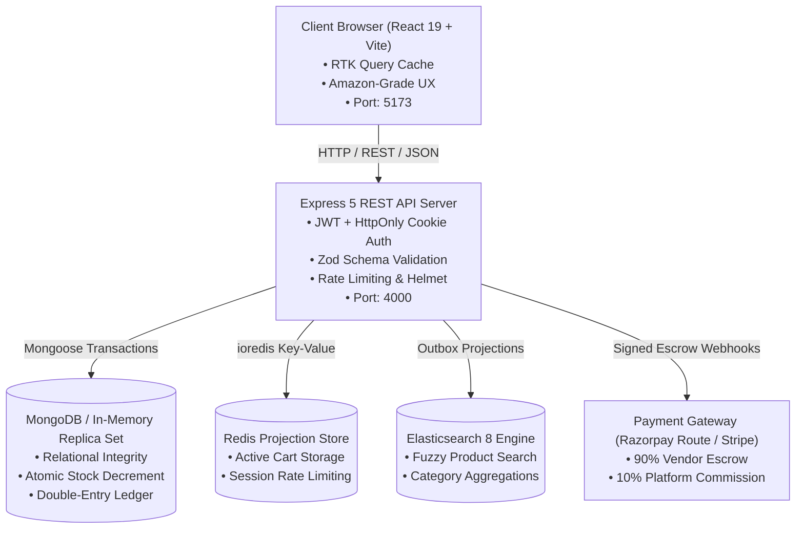
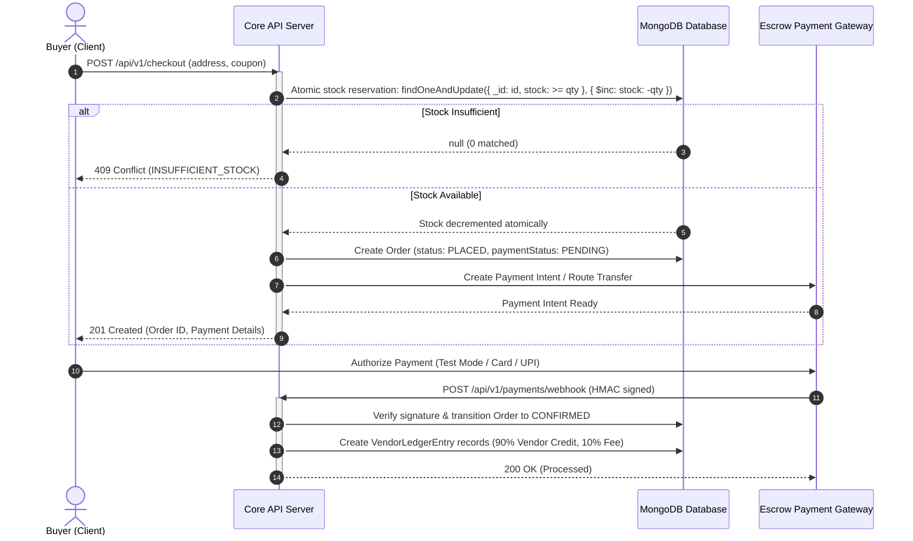

# Architecture & API Specifications — Common Goods (FS-01)

**Project:** Multi-Vendor E-Commerce Marketplace  
**Author:** Yuvraj Negy  
**Document Version:** 1.0.0 (Production Release)  

---

## 1. High-Level System Topology



---

## 2. Core Data Models (Schemas)

### 1. `User` Schema
```typescript
{
  _id: ObjectId,
  name: string,
  email: { type: string, unique: true, lowercase: true },
  passwordHash: string, // bcrypt cost factor 12
  role: 'CUSTOMER' | 'VENDOR' | 'ADMIN',
  isVerified: boolean,
  createdAt: Date,
  updatedAt: Date
}
```

### 2. `VendorProfile` Schema
```typescript
{
  _id: ObjectId,
  userId: ObjectId, // references User
  shopName: { type: string, unique: true },
  description: string,
  status: 'PENDING' | 'APPROVED' | 'REJECTED' | 'SUSPENDED',
  gstin?: string,
  commissionRatePct: number, // default 10%
  bankDetails: {
    accountNumberMasked: string,
    ifscCode: string,
    accountHolderName: string
  },
  createdAt: Date,
  updatedAt: Date
}
```

### 3. `Product` Schema
```typescript
{
  _id: ObjectId,
  vendorId: ObjectId, // references VendorProfile
  name: string,
  category: string, // 'Home & Living' | 'Accessories & Wear' | 'Apothecary & Wellness' | 'Stationery & Paper'
  description: string,
  pricePaise: number, // e.g. 289900 = ₹2,899.00
  mrpPaise: number, // e.g. 399900 = ₹3,999.00
  stock: number, // managed via atomic conditional operations
  imageUrl: string,
  badge?: string, // 'Best Seller' | 'Artisan Pick'
  specs: Record<string, string>,
  ratingAverage: number, // 0.0 - 5.0
  ratingCount: number,
  isPublished: boolean,
  createdAt: Date,
  updatedAt: Date
}
```

### 4. `Order` & `OrderItem` Schema
```typescript
{
  _id: ObjectId,
  customerId: ObjectId, // references User
  items: [
    {
      productId: ObjectId,
      vendorId: ObjectId,
      name: string,
      imageUrl: string,
      quantity: number,
      unitPricePaise: number,
      fulfillmentStatus: 'PENDING' | 'PACKED' | 'SHIPPED' | 'DELIVERED' | 'CANCELLED',
      carrier?: string,
      trackingNumber?: string
    }
  ],
  totalPaise: number,
  discountPaise: number,
  shippingPaise: number,
  appliedCoupon?: string,
  addressSnapshot: {
    recipient: string,
    street: string,
    city: string,
    state: string,
    postalCode: string,
    country: string
  },
  status: 'PLACED' | 'CONFIRMED' | 'PACKED' | 'SHIPPED' | 'DELIVERED' | 'CANCELLED',
  paymentStatus: 'PENDING' | 'ESCROW_HELD' | 'SETTLED' | 'REFUNDED',
  createdAt: Date,
  updatedAt: Date
}
```

### 5. `VendorLedgerEntry` Schema
```typescript
{
  _id: ObjectId,
  vendorId: ObjectId,
  orderId: ObjectId,
  type: 'CREDIT' | 'COMMISSION_DEDUCTION' | 'PAYOUT' | 'REVERSAL',
  grossPaise: number,
  platformFeePaise: number,
  netVendorPaise: number,
  notes: string,
  createdAt: Date
}
```

---

## 3. Checkout & Atomic Concurrency Sequence



---

## 4. Key REST API Catalog

| Method | Endpoint | Access | Description |
|---|---|---|---|
| `POST` | `/api/v1/auth/register` | Public | Register customer account with bcrypt-hashed credentials. |
| `POST` | `/api/v1/auth/login` | Public | Authenticate user; issues JWT and HttpOnly refresh cookie. |
| `GET` | `/api/v1/auth/me` | Authenticated | Retrieve authenticated user profile and roles. |
| `POST` | `/api/v1/auth/logout` | Authenticated | Revoke refresh token and clear session cookies. |
| `GET` | `/api/v1/products` | Public | Search and list products with department, star, and price filters. |
| `GET` | `/api/v1/products/:id` | Public | Retrieve detailed product specifications and ratings. |
| `POST` | `/api/v1/cart/items` | Customer | Add product to Redis-backed multi-vendor shopping cart. |
| `DELETE` | `/api/v1/cart/items/:id` | Customer | Remove line item from cart. |
| `POST` | `/api/v1/checkout` | Customer | Execute atomic stock reservation and initiate multi-vendor order. |
| `GET` | `/api/v1/orders` | Customer | List customer order history with package tracking statuses. |
| `POST` | `/api/v1/orders/:id/cancel` | Customer | Cancel unfulfilled order with immediate stock restoration. |
| `GET` | `/api/v1/orders/:id/invoice` | Customer | Download printable GST-compliant HTML/PDF tax invoice (`?token=` auth). |
| `POST` | `/api/v1/vendor/apply` | Customer | Submit artisan maker onboarding application. |
| `GET` | `/api/v1/vendor/products` | Vendor | List studio inventory and catalog listings. |
| `POST` | `/api/v1/vendor/products` | Vendor | Create new product listing with image assets. |
| `PATCH` | `/api/v1/vendor/orders/:id/fulfillment` | Vendor | Update package state (`PACKED`, `SHIPPED`, `CANCELLED`). |
| `GET` | `/api/v1/vendor/ledger` | Vendor | Inspect studio earnings, 10% commission deductions, and net payouts. |
| `GET` | `/api/v1/admin/analytics` | Admin | System-wide GMV, vendor volume, and platform commission KPIs. |
| `POST` | `/api/v1/admin/coupons` | Admin | Create promotional discount codes (`WELCOME10`, etc.). |
| `PATCH` | `/api/v1/admin/vendors/:id/status` | Admin | Approve or reject pending maker onboarding applications. |
| `GET` | `/api/v1/health/ready` | Public | Healthcheck endpoint reporting database and dependency states. |
