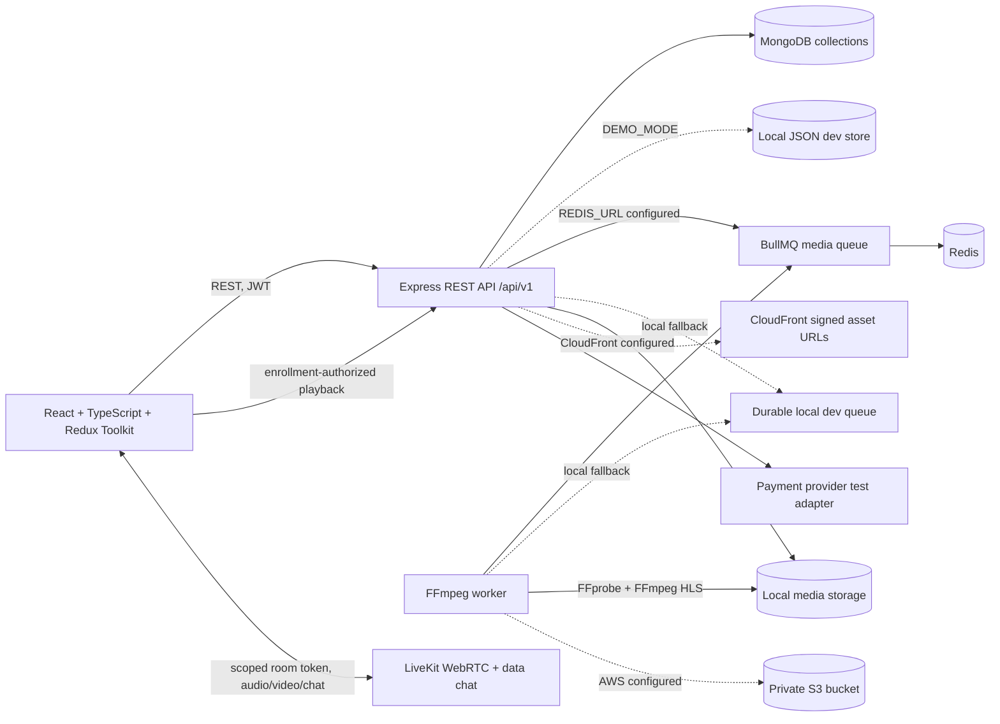
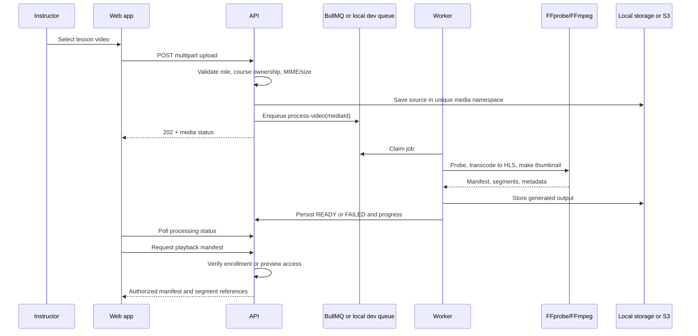

# FS-03 Architecture

## Runtime components

## Data and trust boundaries

- Public catalog responses contain only published course metadata and preview lessons.
- Authentication is role-scoped; resource ownership is checked in the API for instructor edits and student learning access.
- MongoDB is the configured production persistence adapter. `DEMO_MODE=true` enables a durable, local JSON store for a no-credentials demo; it is explicitly development-only.
- With `REDIS_URL`, the API enqueues video processing in BullMQ and the separate worker consumes it. Without Redis, an atomic file-backed development queue executes the same FFmpeg processor.
- Local video objects live under `storage/`; production objects are private in S3. CloudFront signed asset URLs are enabled only when a distribution and signing key are configured.
- Payment confirmation is provider/webhook driven in configured modes. The local mock completion endpoint is enabled only in demo mode and never accepts a frontend redirect as payment proof.
- LiveKit room tokens are issued only when provider credentials are configured. Otherwise, schedule and authorization flows remain available and the UI labels media joining as unconfigured.

## Video processing sequence

## Job contract

`process-video` payload: `{ mediaId: string }`. Job identity is `mediaId`, retries use up to three attempts with exponential backoff, and generated files use a stable per-media output directory. The worker records `QUEUED`, `PROCESSING`, `READY`, or `FAILED`, percentage, safe failure details, probe metadata, manifest path, and timestamps. BullMQ retains a bounded number of recent completed and failed jobs. The local fallback atomically claims a queued JSON file by renaming it before processing.

## API inventory

All endpoints are under `/api/v1`; JSON validation errors use `{ error: { code, message, requestId } }`.

| Area | Endpoints | Access |
|---|---|---|
| Health | `GET /health`, `GET /ready` | Public |
| Identity | `POST /auth/register`, `POST /auth/login`, `POST /auth/logout`, `GET /auth/me` | Public/authenticated |
| Catalog | `GET /courses`, `GET /courses/:courseId` | Public, published only |
| Instructor courses | `POST /instructor/courses`, `PATCH /instructor/courses/:courseId`, `POST /instructor/courses/:courseId/publish`, `POST /instructor/courses/:courseId/lessons` | Instructor owner |
| Enrollment | `POST /courses/:courseId/enroll`, `GET /me/enrollments` | Student |
| Media | `POST /instructor/lessons/:lessonId/media`, `GET /media/:mediaId`, `GET /media/:mediaId/playlist`, `GET /media/:mediaId/assets/:assetName` | Instructor owner or enrolled student/preview |
| Learning | `GET /courses/:courseId/learning`, `POST /lessons/:lessonId/progress` | Enrolled student |
| Quizzes | `GET /courses/:courseId/quiz`, `POST /courses/:courseId/quiz/attempts` | Enrolled student; grading server side |
| Live classes | `POST /instructor/courses/:courseId/live-classes`, `GET /courses/:courseId/live-classes`, `POST /live-classes/:sessionId/join` | Instructor owner/enrolled student |
| Payments | `POST /courses/:courseId/checkout`, `POST /payments/:paymentId/mock-confirm`, `GET /me/payments` | Student; mock confirm demo-only |
| Earnings | `GET /instructor/earnings` | Instructor |
| Certificates | `POST /courses/:courseId/certificate`, `GET /certificates/:certificateId/verify`, `GET /me/certificates/:certificateId.pdf` | Eligible student/public verify |
| Administration | `GET /admin/overview`, `POST /admin/courses/:courseId/review` | Admin |

The generated OpenAPI document at `apps/api/openapi.yaml` is the source of truth for payloads and is served in Swagger UI at `/api/docs` in development.

