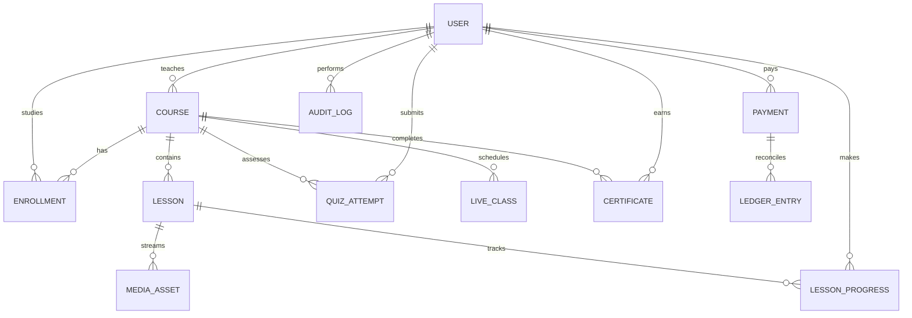

# Data Model

Identifiers are UUID strings in the API. Dates are UTC ISO-8601 values. Monetary amounts are integer minor units. Growing histories are separate records rather than arrays embedded in courses or users.

| Collection | Key fields | Important constraints/indexes |
|---|---|---|
| users | `id`, `name`, `email`, `passwordHash`, `role`, `createdAt` | unique normalized email |
| courses | `id`, `instructorId`, `title`, `slug`, `description`, `category`, `priceMinor`, `currency`, `status`, `sections`, `createdAt`, `updatedAt` | instructor/status, unique slug, public catalog status/category |
| enrollments | `id`, `courseId`, `studentId`, `paymentId`, `status`, `createdAt` | unique `(courseId, studentId)` |
| media_assets | `id`, `lessonId`, `courseId`, `ownerId`, `sourceKey`, `manifestKey`, `status`, `progress`, `metadata` | lesson/status, owner, unique source key |
| lesson_progress | `id`, `studentId`, `courseId`, `lessonId`, `positionSeconds`, `watchedSeconds`, `completedAt`, `lastHeartbeatAt` | unique `(studentId, lessonId)` |
| quiz_attempts | `id`, `studentId`, `courseId`, `answers`, `scorePercent`, `passed`, `createdAt` | course/student/date |
| live_classes | `id`, `courseId`, `instructorId`, `title`, `startsAt`, `endsAt`, `status`, `roomName` | course/start, instructor/start |
| payments | `id`, `studentId`, `courseId`, `amountMinor`, `currency`, `provider`, `providerRef`, `status`, timestamps | unique provider reference when present, student/date |
| ledger_entries | `id`, `paymentId`, `courseId`, `instructorId`, `kind`, `amountMinor`, `currency`, `createdAt` | payment, instructor/date |
| certificates | `id`, `certificateNumber`, `studentId`, `courseId`, `issuedAt`, `revokedAt` | unique certificate number and `(studentId, courseId)` |
| audit_logs | `id`, `actorId`, `action`, `targetType`, `targetId`, `metadata`, `createdAt` | actor/date, target/date |

Courses contain a bounded curriculum of sections and lessons for the MVP. Each lesson refers to its media by ID. Quiz questions are stored in course-owned quiz documents and correct answers are never returned to students before grading. Production initialization uses Mongoose schemas and declared indexes; local demo mode persists the same records to `data/dev-store.json`.

